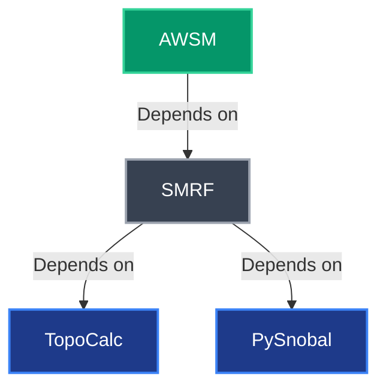

# iSnobal- Conda Install

This folder contains installation instructions for the model including `conda` environment files and a
development environment setup script.

## Model execution environment

The following steps create a new environment to execute the iSnobal model.
Note that environments are provided for both Linux and MacOS systems.
For large iSnobal model runs, users are encouraged to use a Linux machine with adequate compute resources.
The MacOS environment is provided primarily to allow users to run PySnobal (1-D point model) locally
and/or conduct AWSM runs for small domains and periods of time.

### Set up a new conda environment

#### For Linux

```bash
  conda env create -f isnobal_linux.yaml
```

#### For MacOS

```bash
  ./install_isnobal_macOS.sh
```

**Note**: This environment has been configured to run on Macs with both M* (arm64) and Intel (x86-64) CPU architectures. This bash script handles installing the conda environment and configuring the environment target architecture, critical when installing on a newer Mac with an M* (arm64) chip.

### Activate the environment

```bash
  conda activate isnobal
```

### Install the iSnobal model

Once the conda environment is activated, install the iSnobal model.
Note that the `_RELEASE_TAG_` is a placeholder in this case and should be replaced with the actual release name.
The latest release can be found on the [AWSM GitHub repository](https://github.com/iSnobal/awsm/releases).
The package will install all iSnobal modules required to run the model, including SMRF, PySnobal, and TopoCalc.

```bash
  pip install git+https://github.com/iSnobal/awsm.git@_RELEASE_TAG_
```

### Quick test
With a successful setup from above, you should be able to execute

```bash
awsm --help
```

and get the help message for AWSM and how to execute the command.

All done!

## Model development environment

Set up a conda environment with the steps shown above.

### Run the install script

```bash
  ./install_isnobal_development.sh
```

The script takes a user-defined install location as the first argument. The
default location is: `$HOME/iSnobal` if none is provided.

## Releasing a new model version

Updating the conda environment yaml files ([`isnobal_linux.yaml`](isnobal_linux.yaml) and [`isnobal_macOS.yaml`](isnobal_macOS.yaml)) and add any new
or upadted packages if needed. Publish a new version [using GitHub releases](https://docs.github.com/en/repositories/releasing-projects-on-github/managing-releases-in-a-repository#creating-a-release)
on the [AWSM GitHub repository](https://github.com/iSnobal/awsm). AWSM
only depends on [SMRF](https://github.com/iSnobal/smrf) and any updates to the latter should be
completed first before creating a new referenced release from AWSM to SMRF. SMRF in turn depends on
[TopoCalc](https://github.com/iSnobal/topocalc) and [PySnobal](https://github.com/iSnobal/pysnobal)
and any updates to these dependencies should be completed first before creating a new referenced
release from SMRF to TopoCalc and PySnobal.



## Other environments

### Basin Setup

Separate setup to run [basin_setup](https://github.com/USDA-ARS-NWRC/basin_setup)
to prepare a model domain.
